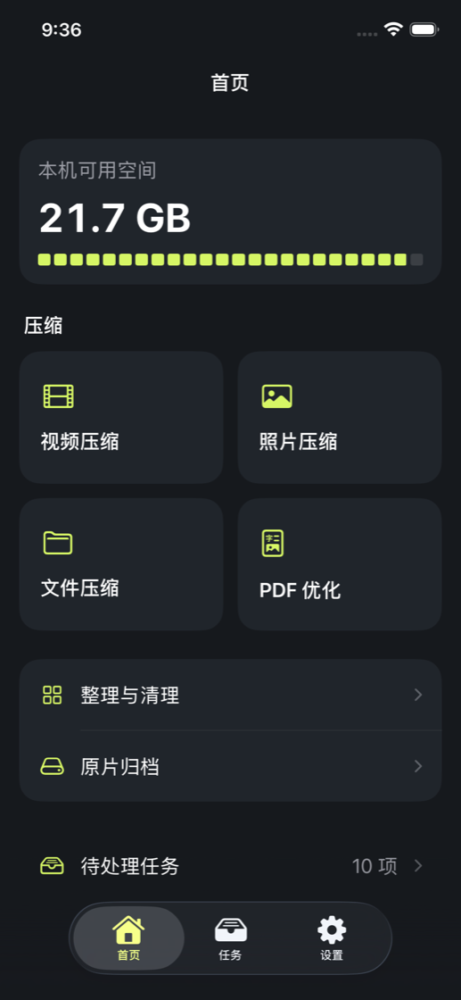
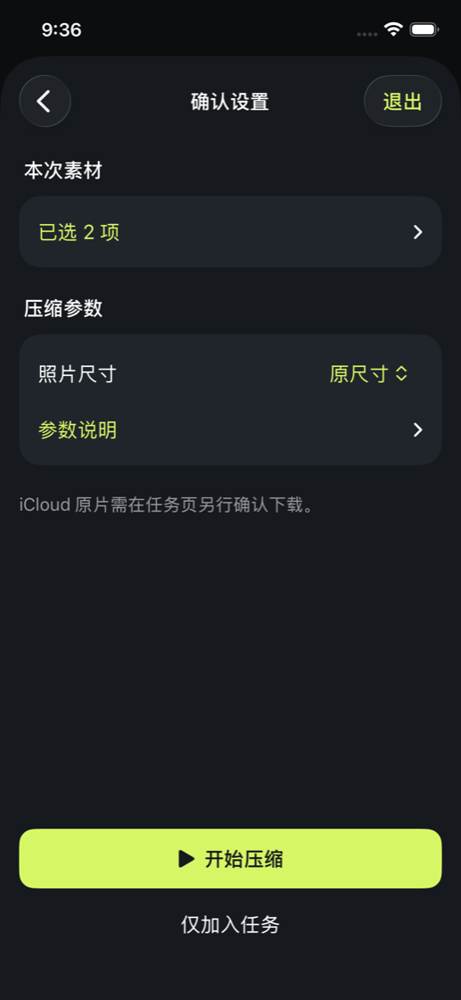
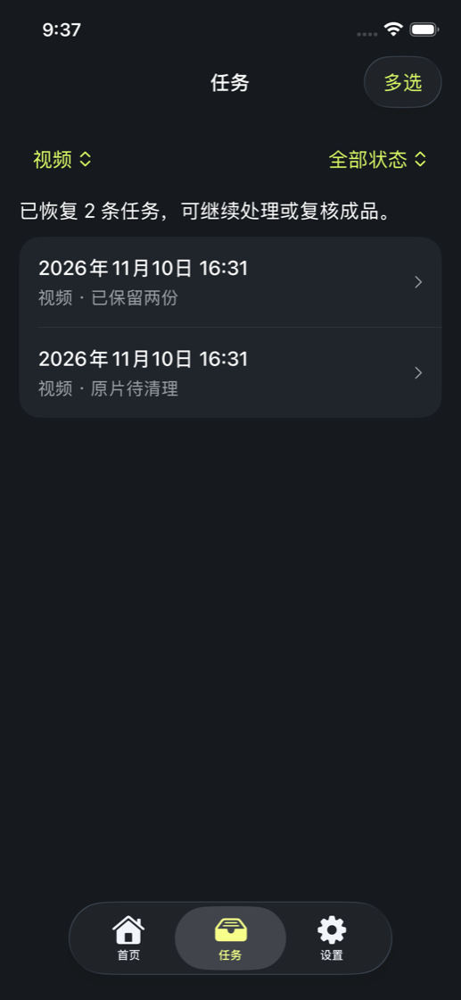

# DisquEZ

[简体中文](README.md) · English

DisquEZ is an iPhone app that compresses videos, photos, and files, organizes your photo library, and archives originals on-device.

**Development version v0.8.2 (build 14)** · **iOS 26+** · SwiftUI

[Features](#features) · [Workflow](#workflow) · [Originals and storage](#originals-and-storage) · [Run locally](#run-locally) · [Testing status](#testing-status)

## Screenshots

<p>
  
  
  
</p>

Home, compression review, and tasks. Captured in the v0.8.2 simulator tests with the Chinese interface.

## Features

| Feature | What it does |
| --- | --- |
| **Video compression** | Outputs HEVC / MOV and keeps the original audio by default. Balanced mode caps resolution at 1080p and Space Saver at 720p. H.264 / MP4 compatibility mode outputs SDR and converts audio to AAC when needed. Compatibility results are exported as copies. HLG and Dolby Vision 8.4 HEVC results can be exported as copies. |
| **Photo compression** | Batch-processes JPEG and HEIC stills at original dimensions or with a long-edge cap of 2560 or 1280 pixels. Zoom in to compare. RAW, Live Photos, bursts, edited photos, and other protected assets are skipped. |
| **Files and PDFs** | Pick files or a folder from Files without granting photo library access. Optimize scanned or image-heavy PDFs, keep existing text, and switch between versions to compare the same page. The limit is 200 pages and 512 MB. Encrypted, signed, and form PDFs are skipped. |
| **Photo library cleanup** | Filter videos by size, duration, 4K, and more. Find exact duplicates among photos and videos, plus potentially similar still photos. Choose an item to keep, then select the items to remove. |
| **Storage plan and archives** | Estimate savings from compression, duplicate cleanup, and archiving toward a storage goal. Exclude favorites and selected albums. Save original files with a manifest, verify them, and restore them. |
| **Professional video** | A one-time purchase unlocks codec, target file size, resolution, bitrate, frame rate, and local presets. Keep the original audio, convert it to AAC, or remove it. Standard compression, batch processing, photo cleanup, and basic archiving are free. |

## Workflow

1. **Select items.** Start from Home with videos, photos, files, or PDFs. You can select a batch.
2. **Review settings.** Check the selected items and settings, then start compression or add them to the queue.
3. **Manage tasks.** Track progress, filter by type and status, or select several tasks to save, pause, cancel, or retry. Confirm downloads for originals stored only in iCloud.
4. **Review results.** Compare the media or PDF pages, check file sizes, and save to Photos or export a copy. Eligible tasks offer a separate replacement review and confirmation.

## Originals and storage

- **Replacing in Photos.** DisquEZ reads back the saved result and checks its file fingerprint and required photo metadata before offering to remove the original. Direct video deletion has a separate confirmation flow. Removed Photos items go to Recently Deleted, and removal can sync to other devices through iCloud Photos.
- **Replacing files.** In-place replacement is limited to eligible writable files in DisquEZ’s own documents folder and requires a full recovery copy. For other locations, export a new copy.
- **Removing archived originals.** Removal can be offered after the archive passes verification and its destination is a confirmed external volume or an iCloud location with verified sync. Restore from the complete archive folder.
- **On-device processing.** Compression and cleanup run on the device. The system downloads iCloud originals on request, and background video compression depends on system approval. File size differences, estimated savings, and available storage are shown separately.

## Run locally

1. Open [DisquEZ.xcodeproj](DisquEZ.xcodeproj) in **Xcode 27**.
2. Select the `DisquEZ` scheme and an iPhone simulator running iOS 26 or later, then press ⌘R.
3. For a physical device, select your development team under **Signing & Capabilities** and adjust the bundle identifier as needed.

```sh
xcodebuild -project DisquEZ.xcodeproj -scheme DisquEZ \
  -destination 'generic/platform=iOS Simulator' \
  -derivedDataPath /tmp/disquez-build CODE_SIGNING_ALLOWED=NO build
```

## Testing status

- **Verified.** v0.8.2 passed 77 core tests and 23 UI flows on the iOS 26.5 simulator. One core purchase test was skipped due to a local StoreKitTest service error.
- **Pending on device.** Live iCloud downloads, system-granted background processing, external drives, VoiceOver, and live StoreKit transactions.
- **Run the tests.** In a dedicated simulator whose name starts with `DisquEZ`, run the photo permission test `test01RequestFullPhotoAccess`, then run `DisquEZTests`. The UI tests use synthetic media, and some remove selected test originals.

[Full test steps and fixtures (Chinese)](https://github.com/AlIenwww/DisquEZ/blob/ba22b8a819deed452e062f154378c88c437ec2a3/README.md#验证) · [Interface design (Chinese)](Design/InterfacePrompt.md) · [App icon design (Chinese)](Design/AppIcon/README.md)
