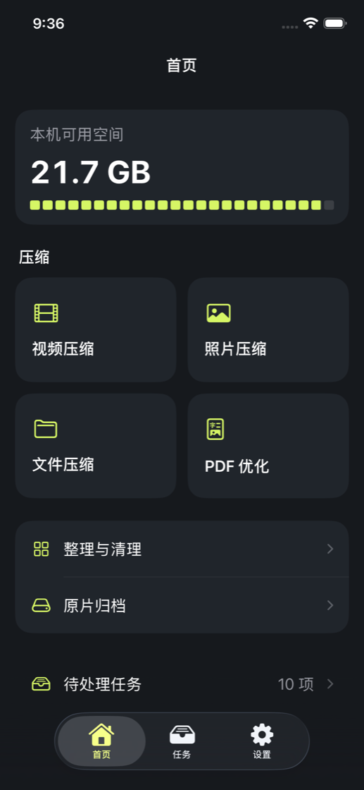
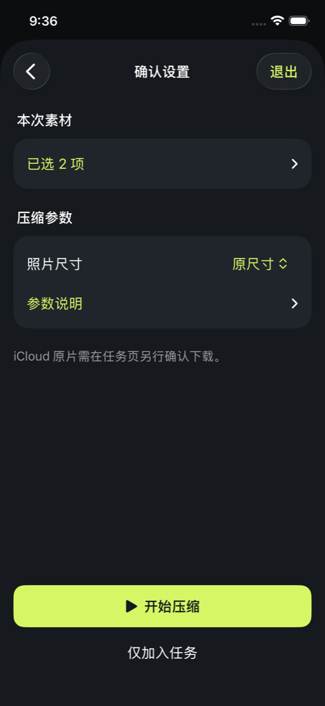
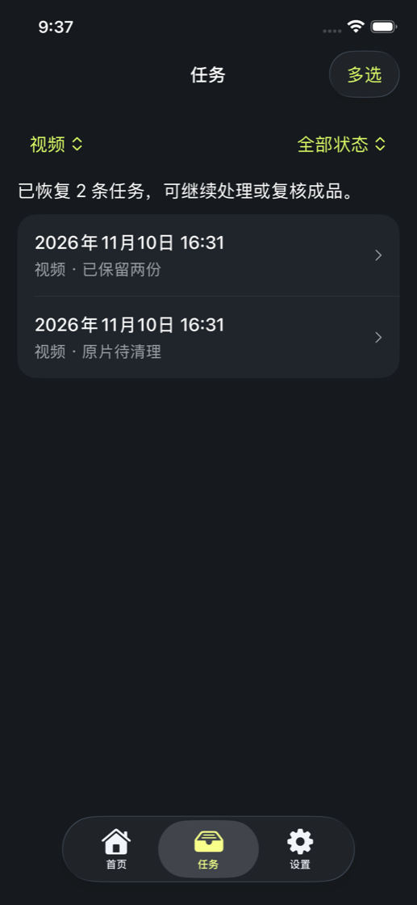

# DisquEZ

简体中文 · [English](README.en.md)

DisquEZ 是一款在 iPhone 本机压缩视频、照片和文件、整理照片库并归档原件的工具。

**开发版本 v0.8.2（构建 14）** · **iOS 26+** · SwiftUI

[主要功能](#主要功能) · [使用流程](#使用流程) · [原件与存储](#原件与存储) · [本地运行](#本地运行) · [测试状态](#测试状态)

## 界面预览

<p>
  
  
  
</p>

首页、压缩确认和任务列表。截图来自 v0.8.2 模拟器测试。

## 主要功能

| 功能 | 能做什么 |
| --- | --- |
| **视频压缩** | 默认输出 HEVC / MOV 并保留原音轨。均衡档最高 1080p，省空间档最高 720p。H.264 / MP4 兼容模式输出 SDR，必要时将音轨转为 AAC，并以副本导出。支持以副本导出 HLG 和 Dolby Vision 8.4 的 HEVC 成品。 |
| **照片压缩** | 批量处理 JPEG、HEIC 静态照片，支持原尺寸、长边最多 2560 或 1280 像素，并可放大对比。RAW、实况、连拍和已编辑照片等素材受保护。 |
| **文件与 PDF** | 从「文件」选择多个文件或一个目录，无需照片库权限。PDF 优化适合扫描件和图片较多的文档，保留已有文字层，支持逐页对比。上限为 200 页、512 MB。加密、签名和含表单的 PDF 会跳过。 |
| **照片库整理** | 按大小、时长、4K 等条件筛选视频；按内容识别完全重复的照片和视频，并为静态照片提供相似候选。复核时先选保留件，再勾选要移除的素材。 |
| **空间清单与归档** | 按容量目标估算压缩、去重和归档的收益，可排除收藏和指定相簿。归档保存原始文件与清单，支持回读核验和恢复。 |
| **专业视频** | 一次性购买解锁编码、目标大小、分辨率、码率、帧率和本机预设，可保留原音轨、转为 AAC 或静音。标准压缩、批量处理、照片整理和基础归档免费。 |

## 使用流程

1. **选材。** 从首页选择视频、照片、文件或 PDF，可批量加入。
2. **确认设置。** 核对素材和参数，选择「开始压缩」或「仅加入任务」。
3. **处理任务。** 在任务页查看进度，按类型和状态筛选，也可多选保存、暂停、取消或重试。仅在 iCloud 的原片需要在任务中明确确认下载。
4. **复核成品。** 对比画面或页面、核对文件大小，再保存到照片库或导出副本。符合条件的任务可进一步复核并确认替换。

## 原件与存储

- **照片库替换。** 先回读保存后的成品，并核对内容指纹及必要的照片信息。满足条件后才可确认移除原片。直接删除视频有独立确认流程。照片库移除会进入「最近删除」，并可能通过 iCloud 照片同步到其他设备。
- **文件替换。** 原位替换限于 DisquEZ 自己文档目录内符合条件的可写文件，且须保留完整恢复副本。其他位置可导出新副本。
- **归档后移除。** 只有归档回读通过，且目标为可确认的外接卷或已核实同步完成的 iCloud 位置，才可能进入原件移除流程。恢复时需要完整归档目录。
- **本机处理。** 压缩和整理在设备上完成。iCloud 原片由系统按需下载，后台压缩取决于系统是否批准。文件大小差额、预计收益和设备可用空间分别显示。

## 本地运行

1. 用 **Xcode 27** 打开 [DisquEZ.xcodeproj](DisquEZ.xcodeproj)。
2. 选择 `DisquEZ` scheme 和运行 iOS 26 或更新版本的 iPhone 模拟器，按 ⌘R。
3. 在真机运行时，在 **Signing & Capabilities** 选择自己的开发团队，并按需调整 Bundle Identifier。

```sh
xcodebuild -project DisquEZ.xcodeproj -scheme DisquEZ \
  -destination 'generic/platform=iOS Simulator' \
  -derivedDataPath /tmp/disquez-build CODE_SIGNING_ALLOWED=NO build
```

## 测试状态

- **已验证。** v0.8.2 在 iOS 26.5 模拟器上通过 77 项核心测试和 23 项界面流程。1 项买断核心测试因本地 StoreKitTest 服务错误跳过。
- **待真机验证。** 真实 iCloud 下载、系统后台续跑、外接盘、VoiceOver 操作和正式商品交易。
- **复测。** 在名称以 `DisquEZ` 开头的专用模拟器上先运行首次照片授权用例 `test01RequestFullPhotoAccess`，再运行 `DisquEZTests`。界面测试使用合成素材，部分用例会移除所选合成原片。

[完整测试步骤与素材准备](https://github.com/AlIenwww/DisquEZ/blob/ba22b8a819deed452e062f154378c88c437ec2a3/README.md#验证) · [界面设计](Design/InterfacePrompt.md) · [图标设计](Design/AppIcon/README.md)
